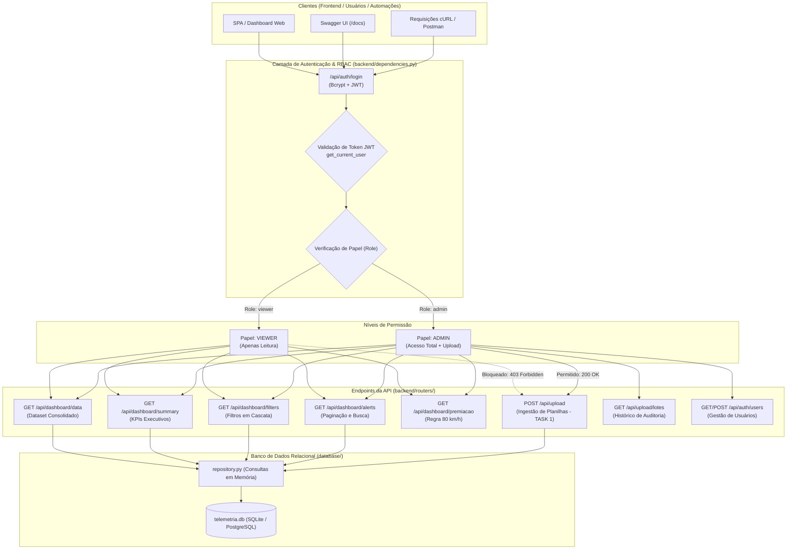

# 📡 Documentação da Camada de Backend e API RESTful (Task 2)
### Painel de Controle de Velocidade e Telemetria da Frota • Casagrande CSG


---

## 1. Visão Geral da Camada de Backend

A camada de backend foi desenvolvida em **FastAPI** de alta performance, integrada ao **SQLAlchemy 2.0**, com o objetivo de:
1. **Servir os dados consolidados da telemetria diretamente da base de dados relacional** (removendo qualquer dependência de arquivos físicos locais como `dashboard_data.json` em tempo de execução).
2. **Implementar autenticação leve e segura via tokens JWT (JSON Web Tokens)** com controle de acesso granular baseado em papéis (**RBAC - Role-Based Access Control**).
3. **Proteger os endpoints de upload e ingestão de arquivos**, garantindo que apenas usuários autenticados como **Admin** consigam enviar novas planilhas de telemetria (acionando o pipeline ETL da Task 1).
4. **Disponibilizar documentação OpenAPI / Swagger UI interativa automática** (`/docs` e `/redoc`) para facilitar a integração com frontends modernos (React, Vue, mobile ou dashboards web).

---

## 2. Diagrama da Arquitetura de Backend e Permissões



---

## 3. Matriz de Perfis e Permissões (RBAC)

O sistema possui tabela de usuários (`usuarios`) com senhas protegidas via **Bcrypt** e papéis definidos no enum `UserRole`:

| Recurso / Rota | Método HTTP | Papel `viewer` | Papel `admin` | Descrição |
| :--- | :---: | :---: | :---: | :--- |
| `/api/auth/login` | `POST` | ✅ Liberado | ✅ Liberado | Autenticação via JSON (retorna JWT) |
| `/api/auth/token` | `POST` | ✅ Liberado | ✅ Liberado | Autenticação OAuth2 Form (para o Swagger) |
| `/api/auth/me` | `GET` | ✅ Liberado | ✅ Liberado | Dados do colaborador logado |
| `/api/auth/users` | `GET` / `POST` | ❌ **403 Forbidden** | ✅ Liberado | Listar e criar novos usuários |
| `/api/dashboard/data` | `GET` | ✅ Liberado | ✅ Liberado | Dataset completo consolidado do banco |
| `/api/dashboard/summary` | `GET` | ✅ Liberado | ✅ Liberado | Resumo de KPIs executivos da frota |
| `/api/dashboard/filters` | `GET` | ✅ Liberado | ✅ Liberado | Opções dinâmicas para menus de filtros |
| `/api/dashboard/alerts` | `GET` | ✅ Liberado | ✅ Liberado | Busca analítica paginada de alertas |
| `/api/dashboard/rankings`| `GET` | ✅ Liberado | ✅ Liberado | Ranking de reincidentes (motorista/veículo) |
| `/api/dashboard/premiacao`| `GET`| ✅ Liberado | ✅ Liberado | Dossiê de apuração de premiação (80 km/h) |
| `/api/veiculos` | `GET` | ✅ Liberado | ✅ Liberado | Listagem de veículos cadastrados |
| `/api/motoristas` | `GET` | ✅ Liberado | ✅ Liberado | Listagem de motoristas cadastrados |
| `/api/upload` | `POST` | ❌ **403 Forbidden** | ✅ **Liberado** | **Envio e ingestão de planilhas Excel/CSV (Task 1)** |
| `/api/upload/lotes` | `GET` | ✅ Liberado | ✅ Liberado | Histórico de auditoria dos lotes ingeridos |
| `/api/health` | `GET` | ✅ Público | ✅ Público | Health check e diagnóstico do banco |
| `/docs` e `/redoc` | `GET` | ✅ Público | ✅ Público | Documentação interativa Swagger/ReDoc |

### Credenciais Padrão Pré-Instaladas (Seed Automático):
- **Administrador:** `admin` / `admin123` (Role: `admin`)
- **Visualizador:** `viewer` / `viewer123` (Role: `viewer`)

---

## 4. Referência Completa de Endpoints

### 4.1. Autenticação e Gestão de Usuários

#### `POST /api/auth/login`
- **Descrição:** Autentica o usuário com nome de usuário e senha, retornando o token JWT Bearer assinado.
- **Requisição (JSON):**
  ```json
  {
    "username": "admin",
    "password": "admin123"
  }
  ```
- **Resposta de Sucesso (200 OK):**
  ```json
  {
    "access_token": "eyJhbGciOiJIUzI1NiIsInR5cCI6IkpXVCJ9...",
    "token_type": "bearer",
    "role": "admin",
    "username": "admin",
    "nome_completo": "Administrador CSG"
  }
  ```
- **Resposta de Erro (401 Unauthorized):**
  ```json
  {
    "detail": "Credenciais incorretas: Usuário ou senha inválidos."
  }
  ```

#### `GET /api/auth/me`
- **Cabeçalho Obrigatório:** `Authorization: Bearer <token>`
- **Resposta de Sucesso (200 OK):**
  ```json
  {
    "id": 1,
    "username": "admin",
    "email": "admin@casagrandelocacoes.com.br",
    "role": "admin",
    "nome_completo": "Administrador CSG",
    "ativo": true,
    "created_at": "2026-10-26T22:15:38"
  }
  ```

---

### 4.2. Dados do Dashboard (Diretamente do Banco de Dados)

#### `GET /api/dashboard/data`
- **Descrição:** Substitui a leitura direta de arquivos locais (`dashboard_data.json`). Busca todos os alertas de velocidade diretamente no banco SQLite/PostgreSQL e formata a resposta com a estrutura completa exigida pelo dashboard.
- **Cabeçalho:** `Authorization: Bearer <token>` (Viewer ou Admin)
- **Resposta (200 OK):**
  ```json
  {
    "meta": {
      "app_name": "Controle_Velocidade_CSG",
      "total_file_alerts": 16067,
      "total_speed_alerts": 9051,
      "period": "26/09/2026 a 25/10/2026",
      "uo": "CASAGRANDE",
      "telemetry_distribution": {
        "EXCESSO_VELOCIDADE": 5418,
        "EXCESSO_VELOCIDADE_POR_VIA": 3632,
        "PARADO_LIGADO": 2640,
        "BOCEJO": 937
      },
      "categorias": ["CAVALO", "CAÇAMBA", "COMBOIO", "LEVES", "MUNK", "PIPA", "ÔNIBUS"],
      "category_plates": {
        "CAVALO": ["UGY5G31", "UGZ1E81", "..."]
      },
      "placas": ["...", "..."],
      "motoristas": ["...", "..."],
      "tipos": ["EXCESSO_VELOCIDADE", "EXCESSO_VELOCIDADE_POR_VIA"],
      "logradouros": ["MS-436", "MS-112", "MS-320", "..."],
      "datas": ["26/09/2026", "...", "25/10/2026"]
    },
    "records": [
      {
        "id": 1,
        "placa": "GCB8F87",
        "prefixo": "-",
        "categoria": "LEVES",
        "motorista": "Sem Identificação",
        "cpf": "-",
        "uo": "CASAGRANDE",
        "tipo": "EXCESSO_VELOCIDADE_POR_VIA",
        "nivel": "MEDIO",
        "limiar": 80.0,
        "limiar_str": "80 km/h",
        "velocidade": 95.0,
        "valor": 95.0,
        "valor_str": "95 km/h",
        "delta": 15.0,
        "delta_str": "+15 km/h",
        "pct": 18.75,
        "duracao_str": "00:00:15",
        "duracao_sec": 15,
        "logradouro": "MS-436",
        "cidade": "Figueirão",
        "estado": "MS",
        "lat": -18.6792,
        "lng": -53.6371,
        "data": "26/09/2026",
        "hora": "06:12:30",
        "hour": 6,
        "status": "NOVO"
      }
    ]
  }
  ```

#### `GET /api/dashboard/summary`
- **Descrição:** Retorna os indicadores resumidos para preencher os cards principais de telemetria.
- **Resposta (200 OK):**
  ```json
  {
    "total_alertas": 16067,
    "total_velocidade": 9051,
    "total_veiculos": 36,
    "total_motoristas": 21,
    "periodo": "26/09/2026 a 25/10/2026",
    "distribuicao_telemetria": {
      "EXCESSO_VELOCIDADE": 5418,
      "EXCESSO_VELOCIDADE_POR_VIA": 3632,
      "PARADO_LIGADO": 2640
    }
  }
  ```

#### `GET /api/dashboard/alerts`
- **Parâmetros de Consulta (Query):**
  - `page`: Número da página (padrão: `1`)
  - `page_size`: Quantidade por página (padrão: `50`, máx: `500`)
  - `placa`: Filtro por substring da placa
  - `categoria`: Filtro por categoria do veículo
  - `motorista`: Filtro por nome do motorista
  - `tipo`: Tipo exato do evento
  - `nivel`: Severidade (`BAIXO`, `MEDIO`, `ALTO`)
  - `data_inicio` / `data_fim`: Intervalo de datas (`AAAA-MM-DD`)
  - `min_velocidade`: Velocidade mínima em km/h
- **Resposta (200 OK):**
  ```json
  {
    "total": 9051,
    "page": 1,
    "page_size": 50,
    "total_pages": 182,
    "items": [...]
  }
  ```

#### `GET /api/dashboard/premiacao`
- **Parâmetros:** `limite_kmh` (padrão: `80.0`)
- **Descrição:** Apura a elegibilidade de motoristas de caminhões pesados para a premiação de direção segura.

---

### 4.3. Upload e Ingestão de Planilhas (Protegido por Role: Admin)

#### `POST /api/upload`
- **Permissão:** **Exclusivo para perfil `admin`**.
- **Comportamento por perfil:**
  - Usuário com role `admin`: Processa o arquivo, aciona o pipeline ETL da Task 1 e grava lote de auditoria.
  - Usuário com role `viewer`: Retorna **HTTP 403 Forbidden** com mensagem `"Acesso negado. Ação restrita aos perfis: [admin]. Seu perfil atual é 'viewer'."`
  - Não autenticado: Retorna **HTTP 401 Unauthorized**.
- **Parâmetros Form-Data:**
  - `file`: Arquivo binário (`.xlsx`, `.xls` ou `.csv`).
- **Parâmetros Query:**
  - `mode`: Modo de carga (`upsert`, `clean_insert`, `replace`). Padrão: `upsert`.
  - `export_json`: Se `true`, sincroniza também o arquivo estático `dashboard_data.json`.
- **Resposta de Sucesso (200 OK):**
  ```json
  {
    "arquivo": "Historico_Alertas.xlsx",
    "lote_id": 2,
    "modo": "upsert",
    "total_lidas": 16067,
    "inseridos": 0,
    "atualizados": 16067,
    "total_velocidade": 9051,
    "tempo_segundos": 14.28,
    "status": "SUCESSO",
    "erros": [],
    "uploaded_by": "admin",
    "message": "Planilha 'Historico_Alertas.xlsx' processada e banco de dados sincronizado com sucesso."
  }
  ```

#### `GET /api/upload/lotes`
- **Descrição:** Retorna a trilha de auditoria completa de todos os lotes de planilhas já ingeridos no sistema.

---

## 5. Como Executar e Testar a API

### 5.1. Inicialização do Servidor de Desenvolvimento

Execute o utilitário na raiz do projeto:

```powershell
python server.py --host 0.0.0.0 --port 8000 --reload
```

A saída exibirá os pontos de acesso:
```
=================================================================
>> SERVIDOR BACKEND API - CASAGRANDE CSG
[*] Escutando em: http://0.0.0.0:8000
[*] Documentacao Swagger UI: http://localhost:8000/docs
[*] Documentacao ReDoc:      http://localhost:8000/redoc
[*] Health Check:            http://localhost:8000/api/health
=================================================================
```

### 5.2. Testando via Swagger UI Interativo

1. Abra o navegador em: [http://localhost:8000/docs](http://localhost:8000/docs).
2. Clique no botão verde **Authorize** no canto superior direito.
3. Insira as credenciais do administrador (`admin` / `admin123`) ou do visualizador (`viewer` / `viewer123`).
4. Clique em **Authorize** e feche a janela modal.
5. Agora você pode executar requisições em qualquer endpoint da documentação:
   - Teste `GET /api/dashboard/summary` e clique em **Execute**.
   - Teste `POST /api/upload` autenticado como `admin` (enviando um `.xlsx`) $\to$ Retorno **200 OK**.
   - Alterne para o token de `viewer` e tente enviar uma planilha $\to$ Retorno **403 Forbidden**.

### 5.3. Executando a Suíte de Testes Automatizados

A suíte conta com **66 testes automatizados** cobrindo limpeza de dados, modelos ORM, pipeline ETL, autenticação JWT, controle de papéis RBAC e endpoints de upload:

```powershell
pytest tests/ -v
```

Resultado verificado:
```
tests/test_api_auth.py ............                               [ 16%]
tests/test_api_dashboard.py ...........                           [ 30%]
tests/test_api_upload.py .....                                    [ 37%]
tests/test_cleaner.py ...........................                  [ 73%]
tests/test_database.py ...                                         [ 77%]
tests/test_excel_reader.py .....                                   [ 84%]
tests/test_frontend_spa.py .........                               [ 96%]
tests/test_ingestion.py ...                                        [100%]
======================== 75 passed ========================
```

---

## 6. Frontend SPA e Painel Administrativo de Upload (Task 3)

Na **Task 3**, a interface web do Dashboard foi totalmente refatorada para se conectar dinamicamente à API RESTful e fornecer controle visual de permissões (RBAC).

### 6.1. Recursos Implementados na Task 3

1. **Consumo Dinâmico via HTTP (`fetch`):**
   - Substituição da dependência de arquivos estáticos client-side pelo endpoint `GET /api/dashboard/data`.
   - Chip de status em tempo real (`#api-status-chip`) com indicador visual (pulsing dot) e botão para sincronização manual de dados.
   - Resiliência com fallback para cache local embutido em caso de indisponibilidade da rede.

2. **Tela e Modal de Login Corporativo:**
   - Modal com suporte a autenticação JWT (`#modal-login`).
   - Armazenamento seguro de token no `localStorage` e injeção do cabeçalho `Authorization: Bearer <token>`.
   - Atalhos pré-configurados de 1 clique para testes de perfis:
     - `admin` / `admin123`: Permissões administrativas completas.
     - `viewer` / `viewer123`: Visualização limpa da operação diária.

3. **Painel de Upload e Auditoria Restrito (`Aba 6 - #view-admin`):**
   - Área interativa de **Arrastar e Soltar (Drag & Drop)** e seleção manual de arquivos `.xlsx`, `.xls` e `.csv`.
   - Modos de ingestão configuráveis:
     - `upsert`: Inserção de novos eventos e atualização de existentes por chave composta hash.
     - `clean_insert`: Inserção apenas de novos registros sem sobrescrever histórico.
     - `replace`: Recriação integral da base de dados.
   - Feedback visual imediato com barra de progresso e card de métricas pós-ETL (Linhas lidas, inseridas, atualizadas e velocidade).
   - Tabela de rastreabilidade de lotes de ingestão (`GET /api/upload/lotes`).

4. **Proteção Visual RBAC (Viewer vs Admin):**
   - Todos os elementos restritos possuem a classe CSS `.admin-only`.
   - Para usuários com papel `viewer` ou deslogados, os botões de upload e a 6ª aba permanecem totalmente ocultos.
   - Tentativas de acesso direto à aba administrativa redirecionam o usuário e emitem toast de acesso restrito.

5. **Arquitetura Desacoplada de Compilação:**
   - [dashboard_template.html](file:///c:/Users/Administrador/Documents/01 - PROJETOS/Dashboard Velocidades CSG/dashboard_template.html): Template limpo e desacoplado.
   - [build_dashboard_html.py](file:///c:/Users/Administrador/Documents/01 - PROJETOS/Dashboard Velocidades CSG/build_dashboard_html.py): Compilador rápido (<0.5s de build) gerando a SPA unificada.
   - Endpoint FastAPI `GET /dashboard` servindo o dashboard diretamente pelo backend.
