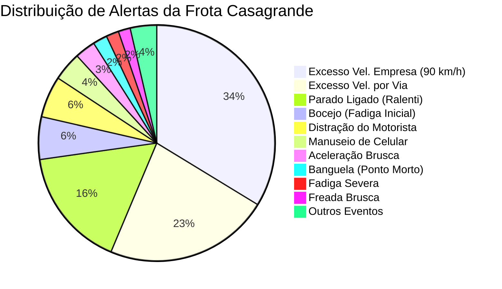

# 📖 Dicionário de Dados e Regras de Negócio da Telemetria

> **Projeto:** Painel de Controle de Velocidade e Telemetria de Frota  
> **Empresa:** Casagrande Locações e Transportes  
> **Versão:** 2.0  
> **Arquivo Base:** `data/Historico_Alertas.xlsx` / `data/Historico_Alertas.csv`  
> **Arquivo de Saída:** `data/dashboard_data.json`  

---

## 1. Origem e Contexto dos Dados

A base de dados é gerada a partir dos relatórios consolidados de telemetria e rastreamento veicular da frota operacional da Casagrande (rastreadores embarcados Sascar / Autotrac e sensores de fadiga/videotelemetria).

O arquivo bruto contém **16.067 eventos** registrados no período operacional de **26/09/2026 a 25/10/2026**. Desses eventos, **9.051 (56,3%)** são relacionados diretamente a infrações de excesso de velocidade e formam o núcleo analítico do dashboard.

---

## 2. Dicionário de Campos da Base Bruta (CSV)

| Campo Bruto CSV | Tipo de Dado | Exemplo | Descrição e Observações |
| :--- | :--- | :--- | :--- |
| `TIPO` | Texto | `EXCESSO_VELOCIDADE` | Tipo de evento de telemetria registrado pelo equipamento embarcado. |
| `EXCESSO` | Texto / Numérico | `102 km/h` ou `102` | Velocidade máxima atingida pelo veículo durante o evento. |
| `LIMIAR` | Texto / Numérico | `80 km/h` ou `80` | Limite de velocidade parametrizado (placa da via ou limite da empresa). |
| `DURACAO` | Texto | `00:02:15` | Tempo decorrido em que o veículo permaneceu acima do limiar. |
| `NIVEL` | Texto | `ALTO`, `MEDIO`, `BAIXO` | Severidade atribuída ao evento pelo sistema de telemetria. |
| `LATITUDE` | Texto / Numérico | `-19.902550` | Latitude geográfica do ponto da infração (WGS84). |
| `LONGITUDE` | Texto / Numérico | `-51.948340` | Longitude geográfica do ponto da infração (WGS84). |
| `DATA` | Texto | `25/10/2026` | Data em que a ocorrência ocorreu. |
| `HORA` | Texto | `10:12:29` | Horário inicial de registro da infração. |
| `MOTORISTA` | Texto | `SENIVALDO COSTA RODRIGUES` | Nome do condutor registrado no iButton/crachá, ou vazio/`Sem Identificação`. |
| `CPF` | Texto | `96521430149` | Cadastro de Pessoa Física do motorista. |
| `CATEGORIA` | Texto | `CAVALO`, `CAÇAMBA`, `LEVE` | Categoria funcional do veículo na frota. |
| `PLACA` | Texto | `UGY5G31` | Placa de identificação veicular (padrão Mercosul ou cinza). |
| `PREFIXO` | Texto | `Z8852D89A` | Código interno ou ID do equipamento de rastreamento no veículo. |
| `LOGRADOURO` | Texto | `MS-112`, `MS-320` | Rodovia, avenida ou logradouro onde ocorreu o evento. |
| `CIDADE` | Texto | `Inocência`, `Três Lagoas` | Município da ocorrência. |
| `ESTADO` | Texto | `Mato Grosso do Sul` | Unidade federativa da ocorrência. |
| `UO` | Texto | `CASAGRANDE` | Unidade Operacional gestora do contrato/veículo. |
| `STATUS` | Texto | `NOVO` | Situação operacional do alerta na fila de monitoramento. |

---

## 3. Regras de Limpeza, Higienização e Transformação (ETL)

### 3.1. Tratamento Numérico (`parse_num_clean`)
- **Problema:** O CSV original pode trazer unidades acopladas aos números, como `102 km/h`, `+15 km/h`, `2500 rpm` ou `0,5 g`.
- **Ação:** Aplica expressão regular `(?i)km/h/s|km/h|kmh|rpm|g|segundos|seg|s|[%+]` para remover qualquer sufixo ou prefixo de texto.
- **Tratamento de Decimal:** Substitui vírgula (`,`) por ponto (`.`) e converte para `float`. Valores vazios, nulos ou traços (`-`) são tratados como `None`.

### 3.2. Tratamento de Coordenadas Geográficas (`fix_coord`)
- **Problema:** Em algumas exportações legadas de GPS, os pontos decimais das coordenadas são suprimidos (exemplo: `-19902550` em vez de `-19.902550`).
- **Ação:** Caso a coordenada venha como número inteiro sem ponto, o script preserva o sinal negativo, isola os 2 primeiros dígitos antes do separador e formata como latitude/longitude decimal com 6 casas de precisão.

### 3.3. Resolução Heurística de Datas Brasileiras (`resolve_dates_br`)
- **Problema:** Arquivos manipulados em diferentes versões do Excel podem misturar formatos `DD/MM/YYYY` e `MM/DD/YYYY`.
- **Ação:** O pipeline analisa todas as ocorrências de datas com valores de dias $> 12$. Se apenas o primeiro elemento exceder 12, infere que a convenção geral é `DD/MM/YYYY`. Caso contrário, alinha os dias e meses de forma consistente, gerando sempre o padrão brasileiro padronizado `DD/MM/AAAA`.

### 3.4. Higienização Textual e Acentuação (`fix_text_encoding`)
- Corrige anomalias de caracteres geradas por dupla codificação CP1252/UTF-8 (como caracteres de substituição `\ufffd` ou representações corrompidas de `CAÇAMBA`, `JOÃO`, `FRANÇA`, `Identificação`).
- Padroniza condutores sem cadastro de iButton para **"Sem Identificação"**.

---

## 4. Dicionário do Objeto Estruturado (`dashboard_data.json`)

Cada item da lista `records` no JSON final possui a seguinte estrutura:

```typescript
interface SpeedRecord {
  id: number;                 // Identificador único sequencial (1 a N)
  placa: string;              // Placa do veículo (ex: "UGY5G31")
  prefixo: string;            // Prefixo / ID do rastreador
  categoria: string;          // Categoria ("CAVALO", "CAÇAMBA", "LEVE", etc.)
  motorista: string;          // Nome completo ou "Sem Identificação"
  cpf: string;                // CPF do condutor ou "-"
  uo: string;                 // Unidade operacional ("CASAGRANDE")
  tipo: string;               // "EXCESSO_VELOCIDADE" ou "EXCESSO_VELOCIDADE_POR_VIA"
  nivel: "ALTO" | "MEDIO" | "BAIXO"; // Grau de severidade do excesso
  limiar: number;             // Limite regulamentar em km/h (ex: 80.0)
  limiar_str: string;         // Limite formatado (ex: "80 km/h")
  velocidade: number;         // Velocidade atingida em km/h (ex: 102.0)
  valor: number;              // Alias de velocidade para compatibilidade
  valor_str: string;          // Velocidade formatada (ex: "102 km/h")
  delta: number;              // Excesso absoluto: velocidade - limiar (ex: 22.0)
  delta_str: string;          // Excesso formatado (ex: "+22 km/h")
  pct: number;                // Excesso percentual: (delta / limiar) * 100 (ex: 27.5)
  duracao_str: string;        // Tempo formatado "HH:MM:SS" (ex: "00:03:05")
  duracao_sec: number;        // Duração total em segundos (ex: 185)
  logradouro: string;         // Rodovia / via (ex: "MS-112")
  cidade: string;             // Município (ex: "Inocência")
  estado: string;             // Estado (ex: "Mato Grosso do Sul")
  lat: number | null;         // Latitude WGS84
  lng: number | null;         // Longitude WGS84
  data: string;               // Data no padrão "DD/MM/AAAA" (ex: "25/10/2026")
  hora: string;               // Hora "HH:MM:SS" (ex: "10:12:29")
  hour: number;               // Hora inteira 0-23 para agregação por turnos
  status: string;             // Status operacional do registro ("NOVO")
}
```

---

## 5. Regras de Classificação de Risco e Severidade

Caso o sistema de rastreamento não forneça o campo `NIVEL` explícito, o pipeline calcula a severidade segundo a regra do Código de Trânsito Brasileiro (CTB) adaptada à política interna da frota Casagrande:

$$\text{Delta} = \text{Velocidade Medida} - \text{Limite Permitido}$$

1. **Gravidade ALTO (Crítica):** $\text{Delta} \ge 20 \text{ km/h}$ ou excesso superior a $50\%$ do limite da via.  
   - *Ação requerida:* Notificação imediata ao gestor de segurança, registro de ocorrência grave e contato com o condutor.
2. **Gravidade MEDIO (Alerta):** $10 \text{ km/h} \le \text{Delta} < 20 \text{ km/h}$.  
   - *Ação requerida:* Advertência orientativa no fechamento semanal de telemetria.
3. **Gravidade BAIXO (Leve):** $\text{Delta} < 10 \text{ km/h}$.  
   - *Ação requerida:* Monitoramento de reincidência e feedback nos treinamentos periódicos.

---

## 6. Mapeamento das Categorias de Veículos da Frota

A frota da Casagrande é distribuída nas seguintes categorias operacionais:

| Categoria | Descrição Funcional | Veículos (Placas de Exemplo) | Limite Operacional Padrão |
| :--- | :--- | :--- | :--- |
| **CAVALO** | Cavalos mecânicos pesados (cavalos trucados e carretas bi-trem) | `UGY5G31`, `QAS8I69`, `OOG7B71`, `NRZ2826` | 80 km/h (Caminhão) |
| **CAÇAMBA** | Caminhões basculantes / caçambas pesadas de terraplenagem | `RVH9A52`, `RWH3J36`, `SLY0B50`, `SMJ5C10` | 80 km/h (Caminhão) |
| **COMBOIO** | Caminhões de lubrificação, abastecimento e manutenção de campo | `RWG4D55`, `RWH7I76` | 80 km/h (Caminhão) |
| **PIPA** | Caminhões tanque / pipa para umectação de vias e poeira | `RWE1J53`, `RWG7I12`, `RWG9H52`, `SMK0F17` | 80 km/h (Caminhão) |
| **MUNK** | Caminhões com guindaste articulado (Munck) | `RWI4I99` | 80 km/h (Caminhão) |
| **ONIBUS** | Ônibus e micro-ônibus de transporte de colaboradores | `SLY2F45` | 80 km/h (Passageiros) |
| **LEVE** | Caminhonetes 4x4, picapes e veículos leves de supervisão | `RWG3A16`, `RWE5G04`, `SLZ8E84`, `SMB0C86` | 90 km/h / 110 km/h (Via) |

---

## 7. Distribuição dos Alertas de Telemetria Geral

Além dos excessos de velocidade, a base consolidada (`16.067` eventos) monitora toda a saúde comportamental da condução:



O dashboard mantém essa contagem global em metadados (`meta.telemetry_distribution`), permitindo que a liderança visualize o peso proporcional da velocidade frente a outros comportamentos de risco (como uso de celular, não uso do cinto e fadiga).
