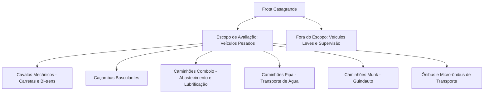

# 🏆 Regulamento Operacional: Programa de Premiação de Direção Segura (Motorista x Caminhão)

> **Empresa:** Casagrande Locações e Transportes  
> **Área Gestora:** Gestão de Frotas, Operações e SESMT  
> **Aplicação:** Todos os motoristas e operadores de caminhões pesados  
> **Ciclo de Avaliação:** Mensal (Fechamento do dia 26 ao dia 25)  
> **Status:** Vigente  

---

## 1. Justificativa e Objetivos Estratégicos

O transporte rodoviário de cargas, movimentação de materiais e apoio a obras de infraestrutura exigem os mais rigorosos padrões de segurança operacional.

O **Programa de Premiação Motorista x Caminhão** foi instituído com os seguintes objetivos:
1. **Preservação de Vidas:** Eliminar acidentes graves, colisões traseiras e tombamentos nas rodovias de atuação (destaque para MS-112, MS-320, MS-436, MS-377, MS-316 e BR-158).
2. **Eficiência Energética e Sustentabilidade:** Reduzir o consumo de combustível fóssil e as emissões de carbono causados por acelerações abusivas e condução em alta velocidade.
3. **Preservação do Patrimônio:** Diminuir o desgaste prematuro de pneus, lonas de freio, suspensão e trem de força dos caminhões.
4. **Cultura de Reconhecimento:** Valorizar financeiramente e institucionalmente os motoristas que demonstram disciplina, responsabilidade e respeito às normas da empresa.

---

## 2. Escopo de Veículos Avaliados

A premiação é estritamente voltada aos veículos pesados da frota, cujas dimensões e tonelagem impõem maior inércia e distância de frenagem:

---

## 3. Critérios de Avaliação e Regras de Classificação

### 3.1. O Teto Regulamentar de 80 km/h
- **Regra Fundamental:** O limite máximo de velocidade para qualquer caminhão pesado da frota Casagrande é de **80 km/h**.
- **Independência da Sinalização da Rodovia:** Mesmo em trechos de rodovias onde a sinalização permita velocidades superiores para automóveis leves (como 100 km/h ou 110 km/h), os caminhões pesados da empresa devem trafegar a no máximo **80 km/h**.
- **Respeito a Limites Menores:** Em perímetros urbanos, trevos, acessos e curvas sinalizadas com limites inferiores (ex: 40 km/h ou 60 km/h), o condutor deve respeitar a placa local. Contudo, para a premiação, a métrica de desclassificação definitiva é o teto máximo de 80 km/h.

### 3.2. Status de Elegibilidade

| Status | Condição de Telemetria no Mês | Elegibilidade à Premiação |
| :---: | :---: | :---: |
| 🏆 APTO | **Velocidade Máxima $\le 80$ km/h** em 100% dos registros do período | **Classificado** para receber a bonificação integral de direção segura. |
| ❌ INAPTO | **Qualquer registro $> 80$ km/h** em qualquer caminhão pesado | **Desclassificado** da premiação no mês da ocorrência. |

---

## 4. Governança e Uso Obrigatório do Chaveiro iButton

1. **Identificação Eletrônica Mandatória:** Todo condutor deve acoplar seu chaveiro iButton/crachá no leitor da cabine antes de dar partida no motor e mantê-lo até o encerramento da jornada.
2. **Ocorrências "Sem Identificação":**
   - Ocorrências registradas como "Sem Identificação" **não qualificam** nenhum motorista para a premiação.
   - Tais ocorrências geram uma notificação de auditoria ao encarregado do contrato e ao gestor de manutenção para apuração de quem estava conduzindo o veículo.
   - O condutor que desligar, burlar ou deixar de usar o iButton de forma reiterada estará sujeito a processo disciplinar.

---

## 5. Dossiê de Auditoria Individual e Transparência

Para assegurar total transparência, lisura e direito à informação:
1. O dashboard gera o **Dossiê de Premiação do Motorista** acessível pelo botão **"Ver Dossiê"** na Aba 5.
2. O dossiê lista:
   - Velocidade máxima exata atingida pelo condutor.
   - Teto da regra e quantidade de desvios.
   - Relação de todos os caminhões pesados conduzidos pelo profissional no mês.
   - Histórico cronológico detalhado com data, hora, placa, rodovia, cidade e velocidade de cada infração.
3. **Impressão Oficial:** O documento conta com layout formatado para impressão (`Ctrl + P`), contendo campos de assinatura para ciência do condutor e aprovação da gerência.

---

## 6. Recursos de Simulação para Gestão Estratégica

O dashboard disponibiliza um simulador interativo na barra da Aba 5:
- **Teto 80 km/h (Oficial):** Base padrão do regulamento corporativo.
- **Teto 85 km/h (Simulação de Transição):** Permite avaliar o impacto se houvesse uma tolerância operacional de 5 km/h para manobras de ultrapassagem.
- **Teto 90 km/h (Simulação Ampla):** Mostra o comportamento da frota caso apenas o limite de fábrica/empresa fosse considerado.

Esses cenários permitem ao Comitê de Direção Segura da Casagrande acompanhar a evolução da maturidade da equipe ao longo dos meses.
